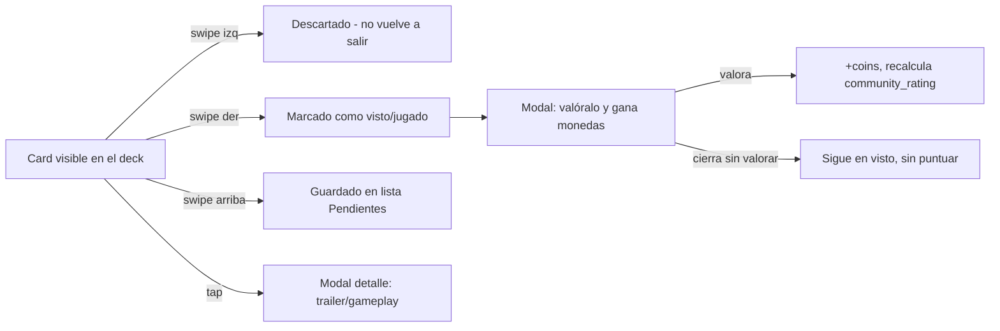

# 📱 Nombre app Hidden — Especificación Técnica para Agente de Desarrollo

> **Nota para el agente**: Este documento es el brief completo del proyecto. Contiene decisiones ya tomadas (síguelas tal cual) y una sección final de "Decisiones pendientes" con temas que debes preguntar al usuario o resolver con un criterio razonable y documentado antes de implementar. "Hidden" es un nombre definitivo.

---

## 0. Contexto y objetivo del documento

App móvil de descubrimiento de contenido (series, películas, anime, manhwa/manga, videojuegos) con interacción tipo Tinder (swipe). El objetivo de este documento es que puedas construir el proyecto de principio a fin: backend, base de datos, ingesta de contenido desde APIs externas, y frontend en React Native.

El usuario que encarga este proyecto sabe React, Node, Go y Spring Boot, pero **nunca ha hecho una app nativa**. Prioriza claridad y decisiones ya masticadas sobre dejar huecos abiertos.

---

## 1. Resumen del producto

**Elevator pitch**: Una app donde deslizas cards de contenido (series, pelis, anime, manhwa, videojuegos) igual que en Tinder. Izquierda = no me interesa. Derecha = ya lo he visto/jugado (y se invita a valorarlo). Arriba = lo guardo en una lista para verlo/jugarlo después.

**Diferenciador clave**: la gente está cansada de que le recomienden siempre lo mismo (*The Last of Us*, *Juego de Tronos*, etc.). La app debe permitir **excluir explícitamente el contenido "mainstream"/sobreexpuesto** del feed, además de filtrar por tipo de contenido y género.

**Usuario objetivo**: consumidores de contenido multi-medio (alguien que ve anime, lee manhwa y juega videojuegos a la vez) que quiere descubrir cosas nuevas sin fricción y sin que el algoritmo le repita siempre el top 10 genérico.

---

## 2. Stack tecnológico recomendado

### Frontend (móvil)
- **React Native + Expo** (managed workflow). Reutiliza el conocimiento de React del usuario; Expo evita configurar Xcode/Android Studio desde el día 1 y permite probar en el móvil real vía Expo Go.
- **Gestos del swipe**: `react-native-gesture-handler` + `react-native-reanimated` (control fino, 60fps, es lo que usan apps de swipe reales). Alternativa más rápida de implementar: `react-native-deck-swiper` (usarla si se prioriza velocidad de desarrollo sobre control fino de la animación).
- **Navegación**: `@react-navigation/native` (stack + bottom tabs).
- **Estado global**: Zustand (más simple que Redux para este alcance).
- **Imágenes**: `expo-image` (cache automático, evita recargar portadas).
- **Vídeo/trailers**: `react-native-youtube-iframe` si los trailers vienen de YouTube (lo más probable), o `expo-av` si se sirven vídeos propios.
- **Peticiones HTTP**: `axios` + `@tanstack/react-query` (cache de requests, estados de loading/error ya resueltos).

### Backend
- **Node.js + Express o NestJS** — recomendado por consistencia con el resto del ecosistema JS del frontend y porque el usuario ya lo domina. Go es una alternativa válida si en algún momento el cuello de botella es rendimiento puro del feed, pero no hay motivo para empezar ahí.
- **PostgreSQL** como base de datos principal (relacional, encaja bien con el modelo de datos de abajo).
- **supabase** (migraciones + tipado + queries legibles).
- **Redis** (opcional, fase 2+): cachear el feed calculado por usuario para no recalcular en cada scroll.
- **Autenticación**: JWT (access + refresh token).
- **Clowdinary**: Guardado de imagenes.

### APIs externas de contenido (fuentes de datos — imprescindibles)
No se puede alimentar la app a mano con miles de fichas. Hay que ingerir contenido de (En un futuro se añadira mas pero por ahora empezaremos asi):

| Tipo de contenido | API recomendada | Notas |
|---|---|---|
| Películas / Series | [TMDB](https://www.themoviedb.org/documentation/api) | Gratuita, sinopsis, portadas, rating de crítica/público, trailers de YouTube ya enlazados |
| Anime / Manga / Manhwa | [AniList](https://anilist.co/graphiql) (GraphQL) o [Jikan](https://jikan.moe/) (wrapper no oficial de MyAnimeList) | AniList tiene mejor cobertura de manhwa coreano; Jikan es más simple si solo se necesita anime/manga |
| Videojuegos | [IGDB](https://api-docs.igdb.com/) (vía Twitch) o [RAWG](https://rawg.io/apidocs) | IGDB tiene mejor dato de rating crítico agregado; RAWG es más simple de integrar |

Todas tienen tier gratuito suficiente para MVP. El agente debe crear cuentas de desarrollador para cada una y guardar las keys en variables de entorno (nunca hardcodeadas).

---

## 3. Modelo de datos

Representación conceptual (adaptar a supabase):

```
User
├─ id, email, password_hash, username, avatar_url
├─ coins (int, default 0)
├─ created_at, updated_at

ContentItem
├─ id
├─ type (enum: movie | series | anime | manhwa | manga | videogame)
├─ title
├─ synopsis (texto corto, 2-3 líneas)
├─ cover_url
├─ release_date
├─ critic_rating (float, 0-10, viene de la API externa: TMDB/IGDB/etc.)
├─ community_rating (float, 0-10, calculado internamente a partir de Rating)
├─ community_rating_count (int)
├─ saves_count (int, cuántos lo han guardado — swipe arriba)
├─ seen_count (int, cuántos lo han marcado como visto — swipe derecha)
├─ trailer_url (nullable)
├─ gameplay_url (nullable, solo videojuegos)
├─ popularity_score (float — usado para detectar "mainstream")
├─ is_mainstream (bool, derivado de popularity_score o marcado manualmente)
├─ genres (relación N:M con Genre)
├─ external_source (enum: tmdb | anilist | igdb | rawg)
├─ external_id (id en la API de origen, para evitar duplicados al re-sincronizar)

Genre
├─ id, name, applies_to (tipo de contenido al que aplica)

UserSwipe
├─ id, user_id, content_id
├─ action (enum: skip | seen | saved)   // izquierda / derecha / arriba
├─ created_at

CustomList
├─ id, user_id, name, is_default (bool — para listas del sistema como "Pendientes" o "Visto")

ListItem
├─ id, list_id, content_id, added_at

Rating
├─ id, user_id, content_id, score (1-5 o 1-10, a decidir), review_text (nullable)
├─ created_at
// Al crearse, dispara: +coins al usuario y recalcula community_rating del ContentItem

CoinTransaction
├─ id, user_id, amount, reason (enum: rating_reward | future_spend), created_at
```

**Reglas de negocio clave**:
- `critic_rating` nunca lo pone el usuario: viene de la fuente externa (Metacritic vía TMDB, agregado de IGDB, etc.).
- `community_rating` es exclusivamente el promedio de la tabla `Rating` de esta app — así se diferencia claramente "nota profesional" vs "nota del público de la app" en la card, tal como se pidió.
- Un `UserSwipe` con `action = skip` no debe volver a aparecer en el feed de ese usuario.
- Un `UserSwipe` con `action = seen` dispara la apertura del modal de valoración en el frontend (no bloqueante — se puede cerrar sin valorar).

---

## 4. Contrato de API (Backend)

```
Auth
POST   /auth/register
POST   /auth/login
POST   /auth/refresh

Feed
GET    /feed?types=anime,videogame&exclude_mainstream=true&genres=1,4&exclude_ids=...
       → devuelve N items no vistos aún por el usuario, respetando filtros

Swipes
POST   /swipes            { content_id, action: skip|seen|saved }

Ratings
POST   /ratings            { content_id, score, review_text? }
       → responde también con las monedas ganadas

Listas
GET    /lists                          → todas las listas del usuario (sistema + custom)
GET    /lists/:id                      → items de una lista concreta
POST   /lists                          { name }
POST   /lists/:id/items                { content_id }
DELETE /lists/:id/items/:content_id

Contenido
GET    /content/:id                    → ficha completa (para el modal de detalle/trailer)

Filtros / metadata
GET    /genres?type=anime
GET    /filters/mainstream-suggestions → lista de los títulos más marcados como "quitar esto" por usuarios, para sugerir excluirlos

Monedas
GET    /coins/balance
GET    /coins/history
```

---

## 5. Pantallas de la app

1. **Onboarding / selección inicial de intereses** — el usuario marca qué tipos de contenido le interesan (anime, manhwa, videojuegos, series, pelis). Esto pre-rellena el panel de filtros.
2. **Auth** (login / registro).
3. **Pantalla principal (Swipe Deck)** — la pantalla core. Ver sección 6.
4. **Panel de filtros** (modal / bottom sheet, se abre desde un botón en la pantalla principal).
5. **Modal de valoración** (aparece tras swipe derecha).
6. **Modal de detalle / trailer** (aparece al tocar la card).
7. **Pantalla de listas** (accesible desde botón lateral) — todas las listas del usuario: Pendientes, Visto/Jugado, listas personalizadas, y alguna lista global tipo "Mejor valorado por la comunidad".
8. **Perfil** — monedas, estadísticas básicas (cuántos ha valorado, cuántos guardados, etc.).

---

## 6. Mecánica central: el swipe

Esta es la pieza más importante de la app — debe sentirse fluida y con feedback visual inmediato (la card debe inclinarse y mostrar un sello de color/ícono mientras se arrastra, antes de soltar).

| Gesto | Acción | Efecto |
|---|---|---|
| **Swipe izquierda** | No me interesa | Se registra `UserSwipe(action=skip)`. La card desaparece del feed para siempre para ese usuario. Sin modal. |
| **Swipe derecha** | Ya lo he visto/jugado | Se registra `UserSwipe(action=seen)`. Se incrementa `seen_count` del contenido. **Inmediatamente se abre el modal de valoración** (ver sección 8). |
| **Swipe arriba** | Guardar para después | Se registra `UserSwipe(action=saved)`. Se incrementa `saves_count`. El item se añade a la lista por defecto "Pendientes" (o a una lista custom si el usuario tiene esa opción activada — ver Decisiones pendientes). |
| **Tap en la card** | Ver más | Abre el modal de detalle con trailer/gameplay embebido (sección 7). No cuenta como swipe. |



---

## 7. La card: contenido y diseño

Cada card del deck debe mostrar, sin necesidad de interacción:
- Portada (imagen de fondo, ocupa la mayor parte de la card)
- Título
- Sinopsis breve (2-3 líneas, truncada con "...")
- Badge de **nota de crítica** (ej. ⭐ 8.2 TMDB/Metacritic)
- Badge de **nota de la comunidad de la app** (ej. 👥 4.5)
- Contador de guardados y/o de gente que lo ha marcado como visto (ej. "🔖 1.2k guardados")
- Tags de género (2-3 máximo, no saturar)

Al tocar (tap, no swipe) → modal con trailer de YouTube embebido (series/pelis/anime) o vídeo de gameplay (videojuegos), más sinopsis extendida.

En cuanto a la estetica quiero que sea similar a la app de globo pero con tonos morados suabes y blancos. 


---

## 8. Modal de valoración + sistema de monedas

Se dispara automáticamente tras un swipe a la derecha.

- Título: algo tipo "¿Qué te pareció [título]?"
- Selector de nota (estrellas 0-5)
- Botón "Valorar y ganar monedas" / botón "Ahora no" (cierra sin penalización, pero sin recompensa), en los ajustes se puede desactivar.
- Al valorar: `POST /ratings`, se acredita una cantidad fija de monedas (ej. +10, configurable) vía `CoinTransaction`, y se recalcula `community_rating` del `ContentItem`.

El **uso de las monedas** (saltar anuncios u otro beneficio) queda fuera del alcance del MVP — implementar solo la acumulación y el histórico (`GET /coins/history`), dejando preparado el modelo de datos para añadir "gastos" más adelante sin migración destructiva.

---

## 9. Panel de filtros

Accesible desde un botón fijo en la pantalla principal (no dentro de la card). Debe permitir:

- **Tipo de contenido** (multi-select): Anime, Manhwa, Manga, Series, Películas, Videojuegos.
- **Excluir contenido mainstream** (toggle general) — usa `is_mainstream` / `popularity_score` del `ContentItem` para filtrar automáticamente los títulos más populares/sobreexpuestos.
- **Exclusión manual** — buscador dentro del propio panel para que el usuario añada títulos concretos a su lista negra personal (ej. "no me vuelvas a enseñar The Last of Us"). Esto requiere una tabla adicional `UserExclusion(user_id, content_id)` que también filtre el `GET /feed`.
- **Filtro por género** dentro de cada tipo de contenido seleccionado.

---

## 10. Sistema de listas

Botón lateral (izquierda, según lo planteado) que abre la pantalla de Listas. Debe incluir por defecto:

- **Pendientes** (todo lo guardado con swipe arriba)
- **Visto / Jugado** (todo lo marcado con swipe derecha)
- **Mejor valorado por la comunidad** (lista global, no personal — top `community_rating` de toda la app, filtrable por tipo)
- Posibilidad de que el usuario cree **listas personalizadas** adicionales (ej. "Animes de terror", "Para jugar en verano")

Cada lista debe mostrarse como grid/lista con toda la data relevante de cada item (portada, nota, tipo), no solo el título.

---

## 11. Ingesta y sincronización de contenido

Como el contenido no lo genera el usuario sino que viene de APIs externas, se necesita un proceso de ingesta:

1. Script/job (cron, ej. diario o semanal) que consulta TMDB / AniList / IGDB por categorías populares y guarda/actualiza registros en `ContentItem`, usando `external_source` + `external_id` como clave de deduplicación (upsert).
2. Al ingerir, calcular un `popularity_score` inicial en base al dato de popularidad que dé la propia API de origen (TMDB y IGDB ya devuelven algo así), y marcar `is_mainstream = true` para los que superen un umbral (a definir, empezar con un percentil, ej. top 5% más popular de su categoría).
3. El `community_rating` empieza en `null`/0 hasta que usuarios de la app empiecen a valorar — no confundir nunca con el `critic_rating` que ya viene precargado de la API externa.

---

## 12. Roadmap de desarrollo sugerido

| Fase | Contenido |
|---|---|
| 0 | Setup: proyecto Expo, backend con Express/Nest, PostgreSQL + Prisma, repos y CI básico |
| 1 | Auth completo + modelos de datos + script de ingesta inicial (aunque sea con 200-300 items de prueba de TMDB/AniList/IGDB) |
| 2 | Pantalla principal con deck de swipe funcional (gestos, animación, las 3 acciones registrando en backend) |
| 3 | Modal de valoración + sistema de monedas (acumulación) |
| 4 | Panel de filtros (tipo de contenido, género, exclusión mainstream, exclusión manual) |
| 5 | Sistema de listas (por defecto + personalizadas) |
| 6 | Modal de detalle con trailer/gameplay embebido |
| 7 | Perfil de usuario + pulido de UI/UX + estados de carga/error |
| 8 (post-MVP) | Uso real de las monedas, notificaciones push, posibles features sociales (ver qué valoran tus amigos, etc.) |

---

## 13. Decisiones pendientes (preguntar al usuario o resolver con criterio razonable documentado)

- **Uso de las monedas**: el usuario mencionó "saltarte anuncios o no sé, hay que mirar esa parte" — no está decidido. No bloquear el MVP por esto; dejar el sistema de acumulación listo y el de gasto como placeholder.
- **Umbral de "mainstream"**: Se define por la populariadad global de una api externa
- **Guardado (swipe arriba)**: Va siempre a la lista de pendientes pero a los relacionados con la categoria del swipe.
- **Cantidad de monedas por valoración**: definir un número fijo inicial 10 y si hay bonus por rachas de valoraciones, en un futuro se valorara la viabilidad de momento dejemos lo asi para testear.
- **Origen de "gameplay"** para videojuegos: automatizar vía API para no depender de curación manual en el MVP.

---

## 14. Criterios de éxito del MVP

- [ ] Un usuario puede registrarse, hacer login y ver un feed de contenido mixto (al menos 2 tipos de contenido con datos reales de las APIs externas).
- [ ] Las 3 acciones de swipe (izquierda/derecha/arriba) funcionan, persisten en backend y no vuelven a mostrar contenido descartado.
- [ ] El swipe derecha dispara el modal de valoración y valorar suma monedas visibles en el perfil.
- [ ] El panel de filtros permite elegir tipos de contenido y excluir mainstream, y el feed refleja esos filtros al momento.
- [ ] Existen al menos las listas "Pendientes" y "Visto/Jugado", pobladas correctamente según las acciones del usuario.
- [ ] Tocar una card abre un modal con trailer o gameplay reproducible.
- [ ] La card muestra nota de crítica y nota de comunidad como dos datos claramente diferenciados.
